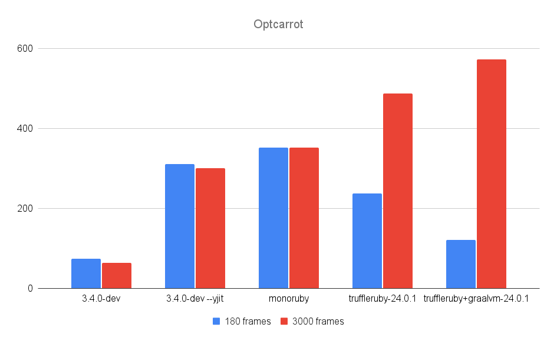
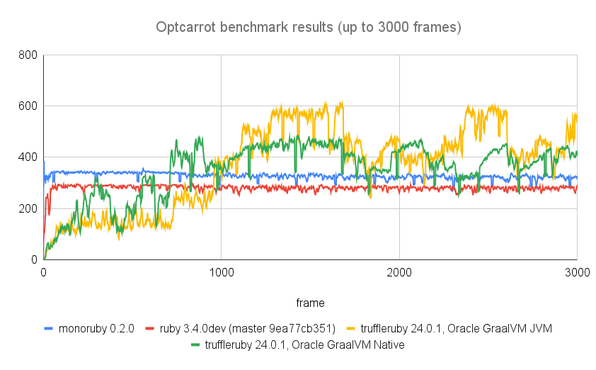
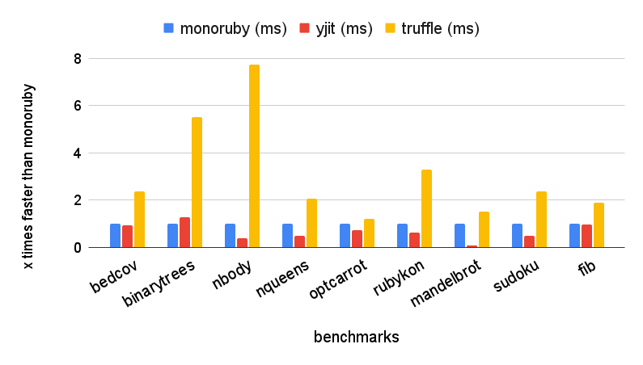

# monoruby

[](https://github.com/sisshiki1969/monoruby/actions/workflows/rust.yml)
[](https://codecov.io/gh/sisshiki1969/monoruby)
[](https://justforfunnoreally.dev)

Ruby implementation with yet another JIT compiler written in Rust.

<!-- BEGIN PORTAL-LINKS: the project portal renders its own link list instead of these two bullets (.github/portal/index.html) -->
- 📖 **[Documentation](https://sisshiki1969.github.io/monoruby/docs/)** — [installation and build](https://sisshiki1969.github.io/monoruby/docs/installation.html), [development and build options](https://sisshiki1969.github.io/monoruby/docs/development.html), [benchmark](https://sisshiki1969.github.io/monoruby/docs/benchmarks.html), [compatibility](https://sisshiki1969.github.io/monoruby/docs/compatibility.html) and the full [changelog](https://sisshiki1969.github.io/monoruby/docs/changelog.html), plus architecture overviews and the design documents.
- 📊 **[Project portal](https://sisshiki1969.github.io/monoruby/)** — benchmark and ruby/spec dashboards, re-measured on every push to `master` that touches the interpreter.
<!-- END PORTAL-LINKS -->

## What's New

Highlights from the last two months; earlier months are in the changelog, linked at the end of this section.

<!-- BEGIN LATEST-MONTHS: generated by bin/sync-changelog-readme; edit docs/src/changelog.md -->

### October 2026

- CRuby-compatible C API layer: C extensions written for CRuby now build with mkmf / `gem install` and load by plain `require` (CRuby's `VALUE` bit layout, `st_table`, `ruby/re.h` over Onigmo, the Time API); real gems (bcrypt, msgpack, strscan, strptime, yajl-ruby, json) run, and CRuby's own `ext/date` ships built against it ([#1742](https://github.com/sisshiki1969/monoruby/pull/1742), [#1743](https://github.com/sisshiki1969/monoruby/pull/1743), [#1744](https://github.com/sisshiki1969/monoruby/pull/1744), [#1746](https://github.com/sisshiki1969/monoruby/pull/1746), [#1748](https://github.com/sisshiki1969/monoruby/pull/1748), [#1765](https://github.com/sisshiki1969/monoruby/pull/1765), [#1776](https://github.com/sisshiki1969/monoruby/pull/1776), [#1778](https://github.com/sisshiki1969/monoruby/pull/1778), [#1780](https://github.com/sisshiki1969/monoruby/pull/1780)).
- Native extensions: markly, bcrypt, digest and OpenSSL's cipher moved out of the core into dynamically loaded extensions, alongside `require` fixes for stub features and repeated `.so` loads ([#1757](https://github.com/sisshiki1969/monoruby/pull/1757), [#1775](https://github.com/sisshiki1969/monoruby/pull/1775)).
- JIT escape analysis: Array / Hash / Range literals, `**kwrest` and multiple assignment are kept elided across statements, calls, loops and merges, and handed into specialized callees; supported by new def-use and liveness tables ([#1747](https://github.com/sisshiki1969/monoruby/pull/1747), [#1750](https://github.com/sisshiki1969/monoruby/pull/1750), [#1751](https://github.com/sisshiki1969/monoruby/pull/1751), [#1752](https://github.com/sisshiki1969/monoruby/pull/1752), [#1753](https://github.com/sisshiki1969/monoruby/pull/1753), [#1754](https://github.com/sisshiki1969/monoruby/pull/1754), [#1755](https://github.com/sisshiki1969/monoruby/pull/1755), [#1756](https://github.com/sisshiki1969/monoruby/pull/1756), [#1758](https://github.com/sisshiki1969/monoruby/pull/1758), [#1759](https://github.com/sisshiki1969/monoruby/pull/1759), [#1760](https://github.com/sisshiki1969/monoruby/pull/1760), [#1761](https://github.com/sisshiki1969/monoruby/pull/1761), [#1764](https://github.com/sisshiki1969/monoruby/pull/1764), [#1769](https://github.com/sisshiki1969/monoruby/pull/1769), [#1771](https://github.com/sisshiki1969/monoruby/pull/1771)).
- Frameless JIT calls: small loop-free callees, `Class#new`'s `initialize`, and small `yield` blocks run inline in a window of the caller's frame, with type-lattice work (nilable lattice, per-ivar types, hoisted loop-invariant guards, all-Fixnum Array speculation) and removal of superseded JIT machinery ([#1689](https://github.com/sisshiki1969/monoruby/pull/1689), [#1707](https://github.com/sisshiki1969/monoruby/pull/1707), [#1710](https://github.com/sisshiki1969/monoruby/pull/1710), [#1711](https://github.com/sisshiki1969/monoruby/pull/1711), [#1712](https://github.com/sisshiki1969/monoruby/pull/1712), [#1714](https://github.com/sisshiki1969/monoruby/pull/1714), [#1718](https://github.com/sisshiki1969/monoruby/pull/1718), [#1723](https://github.com/sisshiki1969/monoruby/pull/1723), [#1729](https://github.com/sisshiki1969/monoruby/pull/1729), [#1731](https://github.com/sisshiki1969/monoruby/pull/1731), [#1787](https://github.com/sisshiki1969/monoruby/pull/1787)).
- Runtime fast paths: inline Integer / Symbol / boolean operators, a 64-bit deopt-free Integer path, Hash `[]` digest baking, String interpolation and byte-append fast paths, cheaper Struct, and Array / `unpack1` / `byteslice` builtins ([#1699](https://github.com/sisshiki1969/monoruby/pull/1699), [#1701](https://github.com/sisshiki1969/monoruby/pull/1701), [#1703](https://github.com/sisshiki1969/monoruby/pull/1703), [#1739](https://github.com/sisshiki1969/monoruby/pull/1739), [#1762](https://github.com/sisshiki1969/monoruby/pull/1762), [#1788](https://github.com/sisshiki1969/monoruby/pull/1788), [#1789](https://github.com/sisshiki1969/monoruby/pull/1789), [#1790](https://github.com/sisshiki1969/monoruby/pull/1790), [#1791](https://github.com/sisshiki1969/monoruby/pull/1791), [#1792](https://github.com/sisshiki1969/monoruby/pull/1792)).
- Concurrency: the fiber scheduler now handles Mutex, Queue, ConditionVariable and `Thread#join` waits and IO waits, plus 1:1 thread signalling and `popen` reaping without the GVL ([#1691](https://github.com/sisshiki1969/monoruby/pull/1691), [#1694](https://github.com/sisshiki1969/monoruby/pull/1694), [#1783](https://github.com/sisshiki1969/monoruby/pull/1783), [#1784](https://github.com/sisshiki1969/monoruby/pull/1784), [#1785](https://github.com/sisshiki1969/monoruby/pull/1785)).
- Fidelity fixes grouped across Integer edge cases, Time UTC offsets, `IO::Buffer`, ARGF, JSON generation and bench tooling for Bundler on monoruby ([#1721](https://github.com/sisshiki1969/monoruby/pull/1721), [#1738](https://github.com/sisshiki1969/monoruby/pull/1738), [#1749](https://github.com/sisshiki1969/monoruby/pull/1749), [#1767](https://github.com/sisshiki1969/monoruby/pull/1767), [#1774](https://github.com/sisshiki1969/monoruby/pull/1774), [#1783](https://github.com/sisshiki1969/monoruby/pull/1783), [#1786](https://github.com/sisshiki1969/monoruby/pull/1786)).

### September 2026

- Real-application benchmarking drive (ruby-bench / yjit-bench: railsbench, lobsters, fluentd, activerecord, erubi, graphql) with a long run of runtime fast paths: frame-free leaf and `Foo.new` expansion, machine-code `Hash#[]` probes, a seeded hash mixer, in-place string/array building, and lazy rubygems boot ([#1217](https://github.com/sisshiki1969/monoruby/pull/1217), [#1240](https://github.com/sisshiki1969/monoruby/pull/1240), [#1247](https://github.com/sisshiki1969/monoruby/pull/1247), [#1255](https://github.com/sisshiki1969/monoruby/pull/1255), [#1261](https://github.com/sisshiki1969/monoruby/pull/1261), [#1263](https://github.com/sisshiki1969/monoruby/pull/1263), [#1313](https://github.com/sisshiki1969/monoruby/pull/1313), [#1365](https://github.com/sisshiki1969/monoruby/pull/1365), [#1547](https://github.com/sisshiki1969/monoruby/pull/1547), [#1601](https://github.com/sisshiki1969/monoruby/pull/1601)).
- GC work: resident allocation budgets, ~45% faster marking, promotion of leaf object types, prefetching queued marks, and releasing JIT pages and thread heaps ([#1238](https://github.com/sisshiki1969/monoruby/pull/1238), [#1252](https://github.com/sisshiki1969/monoruby/pull/1252), [#1256](https://github.com/sisshiki1969/monoruby/pull/1256), [#1259](https://github.com/sisshiki1969/monoruby/pull/1259), [#1262](https://github.com/sisshiki1969/monoruby/pull/1262), [#1300](https://github.com/sisshiki1969/monoruby/pull/1300), [#1466](https://github.com/sisshiki1969/monoruby/pull/1466), [#1484](https://github.com/sisshiki1969/monoruby/pull/1484)).
- JIT and chain-deopt refinement: shared abstract-state frames, polymorphic compare/send handling, method specialization with float registers, and compile-unit-scoped chain deopt, plus a series of `ensure`/non-local-exit splicing fixes ([#1270](https://github.com/sisshiki1969/monoruby/pull/1270)–[#1277](https://github.com/sisshiki1969/monoruby/pull/1277), [#1326](https://github.com/sisshiki1969/monoruby/pull/1326)–[#1337](https://github.com/sisshiki1969/monoruby/pull/1337), [#1351](https://github.com/sisshiki1969/monoruby/pull/1351), [#1363](https://github.com/sisshiki1969/monoruby/pull/1363), [#1370](https://github.com/sisshiki1969/monoruby/pull/1370)–[#1375](https://github.com/sisshiki1969/monoruby/pull/1375), [#1664](https://github.com/sisshiki1969/monoruby/pull/1664), [#1667](https://github.com/sisshiki1969/monoruby/pull/1667)).
- Native extensions and stdlib stand-ins: a dynamically loaded `mr_*` extension ABI with sqlite3 / zlib / zstd / psych / nokogiri moved out of the core, a relocatable install tree, plus Nokogiri (XML, SAX, HTML5, XSLT), Psych over a libyaml port, Prism/Ripper, `io/console`, the json 2.18 port, and fluentd/lobsters C-extension stand-ins ([#1299](https://github.com/sisshiki1969/monoruby/pull/1299), [#1302](https://github.com/sisshiki1969/monoruby/pull/1302), [#1304](https://github.com/sisshiki1969/monoruby/pull/1304), [#1306](https://github.com/sisshiki1969/monoruby/pull/1306)–[#1312](https://github.com/sisshiki1969/monoruby/pull/1312), [#1314](https://github.com/sisshiki1969/monoruby/pull/1314), [#1387](https://github.com/sisshiki1969/monoruby/pull/1387), [#1391](https://github.com/sisshiki1969/monoruby/pull/1391), [#1393](https://github.com/sisshiki1969/monoruby/pull/1393), [#1409](https://github.com/sisshiki1969/monoruby/pull/1409), [#1419](https://github.com/sisshiki1969/monoruby/pull/1419), [#1649](https://github.com/sisshiki1969/monoruby/pull/1649)).
- Encoding overhaul: CRuby's own CJK/ISO/Windows tables, `Encoding::Converter` with UTF-16/32 and its own object type, regexps in every encoding, and a phased encoding plan with a measurement matrix ([#1437](https://github.com/sisshiki1969/monoruby/pull/1437), [#1463](https://github.com/sisshiki1969/monoruby/pull/1463), [#1515](https://github.com/sisshiki1969/monoruby/pull/1515), [#1550](https://github.com/sisshiki1969/monoruby/pull/1550), [#1564](https://github.com/sisshiki1969/monoruby/pull/1564), [#1594](https://github.com/sisshiki1969/monoruby/pull/1594), [#1626](https://github.com/sisshiki1969/monoruby/pull/1626), [#1629](https://github.com/sisshiki1969/monoruby/pull/1629), [#1630](https://github.com/sisshiki1969/monoruby/pull/1630), [#1632](https://github.com/sisshiki1969/monoruby/pull/1632), [#1637](https://github.com/sisshiki1969/monoruby/pull/1637)–[#1641](https://github.com/sisshiki1969/monoruby/pull/1641)).
- Threads: a 1:1 kernel-thread model behind a GVL — signals, fork, JIT/BOP eviction across threads — landed in phases P0–P7 and became the default; `Fiber.schedule`, `Regexp` timeouts and per-thread autoload visibility came along ([#1443](https://github.com/sisshiki1969/monoruby/pull/1443), [#1446](https://github.com/sisshiki1969/monoruby/pull/1446), [#1678](https://github.com/sisshiki1969/monoruby/pull/1678)–[#1685](https://github.com/sisshiki1969/monoruby/pull/1685), [#1687](https://github.com/sisshiki1969/monoruby/pull/1687)).
- ruby/spec and fidelity fixes grouped across Time (zones, exact sub-seconds, strftime), Marshal, ENV, Struct/Data, Float/Rational rounding, Enumerator, and method reflection; the reference CRuby pin moved to 4.0.6 ([#1402](https://github.com/sisshiki1969/monoruby/pull/1402), [#1406](https://github.com/sisshiki1969/monoruby/pull/1406), [#1412](https://github.com/sisshiki1969/monoruby/pull/1412), [#1428](https://github.com/sisshiki1969/monoruby/pull/1428), [#1430](https://github.com/sisshiki1969/monoruby/pull/1430), [#1436](https://github.com/sisshiki1969/monoruby/pull/1436), [#1442](https://github.com/sisshiki1969/monoruby/pull/1442), [#1645](https://github.com/sisshiki1969/monoruby/pull/1645), [#1659](https://github.com/sisshiki1969/monoruby/pull/1659), [#1682](https://github.com/sisshiki1969/monoruby/pull/1682)).
- aarch64 and CI: aarch64 stub reach past ±128MB and ivar-store fixes, daily arm64 benchmarking, and ZJIT as a third benchmark engine ([#1217](https://github.com/sisshiki1969/monoruby/pull/1217), [#1338](https://github.com/sisshiki1969/monoruby/pull/1338), [#1415](https://github.com/sisshiki1969/monoruby/pull/1415), [#1680](https://github.com/sisshiki1969/monoruby/pull/1680), [#1686](https://github.com/sisshiki1969/monoruby/pull/1686)).

<!-- END LATEST-MONTHS -->

Earlier months: [Changelog](https://sisshiki1969.github.io/monoruby/docs/changelog.html) (from January 2026), and [Progress summary (April 2025 – April 2026)](https://sisshiki1969.github.io/monoruby/docs/design/progress_2025-2026.html) for a prose account of the same period.

## Presentation

- Presentation movie and slides for RubyKaigi2024 is [here](https://rubykaigi.org/2024/presentations/s_isshiki1969.html#day2).
- Presentation movie and slides for RubyKaigi2025 is [here](https://rubykaigi.org/2025/presentations/s_isshiki1969.html#day2).

## Features

- Written in Rust from scratch. No dependencies on any other Ruby implementations.
- Fast. Currently, monoruby is comparable to ruby 4.0.5+YJIT/ZJIT on many benchmarks, not just optcarrot.
- Parses Ruby source with [prism](https://github.com/ruby/prism), the official Ruby parser (the original hand-written parser was replaced in May 2026).
- Register-based bytecode.
- Bytecode executor (virtual machine) emitting machine code directly, for both x86-64 and aarch64 (Apple Silicon).
- A compact and fast just-in-time compiler with full backends for x86-64 and aarch64. (internally using self-made dynamic assembler [monoasm](https://github.com/sisshiki1969/monoasm))

## Compatibility

Conformance with Ruby has improved dramatically over the course of 2026, driven by an extensive [ruby/spec](https://github.com/ruby/spec)-based compliance effort.
Pass rates are re-measured on every interpreter change and published on the project portal: as of commit `ebfcdca` (2026-11-08) monoruby passes **99.6%** of the [core specs](https://sisshiki1969.github.io/monoruby/spec/) (23159 / 23264 examples) and **98.5%** of the [library specs](https://sisshiki1969.github.io/monoruby/library/) (6287 / 6384).
As of July 2026 it also passed 100% of the command-line specs and 99.6% of the language specs.
Daily-updated pass statistics, compared with CRuby / TruffleRuby / JRuby, are published at [rubyspec-stats](https://sisshiki1969.github.io/rubyspec-stats/).

The [Compatibility](https://sisshiki1969.github.io/monoruby/docs/compatibility.html) chapter of the documentation breaks the numbers down by category, explains how they are measured, and lists the behaviours that differ from CRuby by design.

## Prerequisites

### Platform

- x86-64 Linux
- aarch64 — macOS on Apple Silicon is fully supported (VM + JIT); CI runs natively on GitHub's Apple Silicon (`macos-latest`) runners. Linux arm64 works as well.

## How to run

See [Installation and Build](https://sisshiki1969.github.io/monoruby/docs/installation.html) for prebuilt binaries, platform notes, what the build installs, and the full command-line reference.

(1) Install Rust.

[Check here to install Rust](https://www.rust-lang.org/tools/install) if you have no Rust yet.

_Caution!!_ **only nightly Rust works** for monoruby. You do not have to select the channel yourself: `rust-toolchain.toml` pins the exact nightly the project is tested against, and `rustup` installs and uses it automatically the first time you run `cargo` in the checkout.

(2) Clone this repository.

```sh
> git clone https://github.com/sisshiki1969/monoruby.git
> cd monoruby
```

(3) Build and run monoruby with Ruby script file.

```sh
> cargo run --release -- test.rb
```

(4) or, Launch REPL.

```sh
> cargo run --bin irm
```

or

```sh
> bin/irm
```

(5) or, install `monoruby` and `irm` onto your `PATH`.

```sh
> bin/install    # cargo install + the native extensions (psych, zlib, …)
> monoruby test.rb
> irm
```

## Using monoruby in GitHub Actions

This repository doubles as a `setup-monoruby` action (see `action.yml`),
modeled after [ruby/setup-ruby](https://github.com/ruby/setup-ruby). The ref
after `@` selects the monoruby version to install:

```yaml
steps:
  - uses: sisshiki1969/monoruby@master # or a release tag
  - run: monoruby my_script.rb
```

The action first tries to download a prebuilt binary attached to a GitHub
release (built by the `release binaries` workflow), which installs in seconds:
release tags use their own release's assets, while `@master` / `@nightly` use
the rolling `nightly` prerelease, rebuilt on every master push (so it
can lag a just-pushed HEAD by one build, ~15 min). Automatic builds cover
x86-64 Linux only; assets for Linux arm64 and macOS arm64 are published on
demand by dispatching the `release binaries` workflow with the wanted tag and
targets. When no asset exists for the ref/platform — or
`prefer-prebuilt: 'false'` is set — the action falls back to building monoruby
from source on the first run for each monoruby revision × runner OS/arch and
caches the resulting binary and runtime tree with `actions/cache`, so
subsequent runs restore in seconds. Linux (x64/arm64) and macOS (Apple
Silicon) hosted runners are supported either way.

Inputs and outputs:

| Name                        | Kind   | Description                                                            |
| --------------------------- | ------ | ---------------------------------------------------------------------- |
| `prefer-prebuilt` (`'true'`)| input  | Set to `'false'` to skip release assets and build the exact ref        |
| `cache` (`'true'`)          | input  | Set to `'false'` to disable the source-build cache                     |
| `cache-version` (`'v1'`)    | input  | Mixed into the cache key; bump to discard existing caches              |
| `prebuilt`                  | output | `'true'` if a prebuilt release asset was used                          |
| `cache-hit`                 | output | `'true'` if the built binary was restored from cache                   |
| `monoruby-version`          | output | Output of `monoruby --version`                                         |
| `ruby-version`              | output | `RUBY_VERSION` reported by the installed monoruby                      |

## Benchmark

Up-to-date benchmark results (yjit-bench, re-measured on every interpreter change) and the ruby/spec compliance dashboards are published on [the project portal](https://sisshiki1969.github.io/monoruby/). On the x86-64 run of commit `a29f308` (2026-11-08), over the 77 benchmarks that completed on both interpreters, monoruby averaged 1.55x the speed of CRuby+YJIT (geometric mean).

The [Benchmarks](https://sisshiki1969.github.io/monoruby/docs/benchmarks.html) chapter of the documentation explains the measurement methodology and how to reproduce a run locally. The numbers below are older one-off measurements, kept for the record.

### 1. Optcarrot benchmark

Several Ruby implementations described below were measured by [optcarrot](https://github.com/mame/optcarrot) benchmark.
See [Benchmarks — optcarrot](https://sisshiki1969.github.io/monoruby/docs/benchmarks.html#optcarrot-april-2024) for details.

#### Versions of used Rubies

- ruby 3.4.0dev (2024-04-27T08:56:20Z master 9ea77cb351) [x86_64-linux]
- truffleruby 24.0.1, like ruby 3.2.2, Oracle GraalVM JVM [x86_64-linux]
- truffleruby 24.0.1, like ruby 3.2.2, Oracle GraalVM Native [x86_64-linux]
- monoruby: 3e348afd4141c40978342e67ad26d42dc0b8d2a7

#### Optcarrot benchmark



#### Optcarrot fps history (0-3000 frames)



### 2. Other benchmarks

Several Ruby implementations described below were measured by [yjit-bench](https://github.com/Shopify/yjit-bench).
See [Benchmarks — yjit-bench](https://sisshiki1969.github.io/monoruby/docs/benchmarks.html#yjit-bench-december-2024) for the raw data.

#### Versions of used Rubies

- monoruby: monoruby 0.3.0
- yjit: ruby 3.4.1 (2024-12-25 revision 48d4efcb85) +YJIT +PRISM [x86_64-linux]
- truffleruby-24.1.1: truffleruby 24.1.1, like ruby 3.2.4, Oracle GraalVM Native [x86_64-linux]

#### Results

The graph shows the speed ratio against truffleruby. (higher is better)


