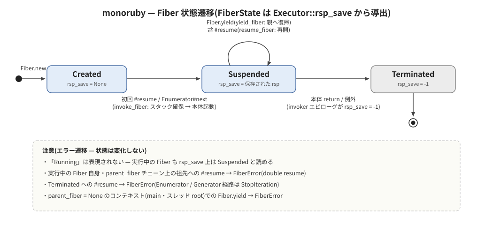
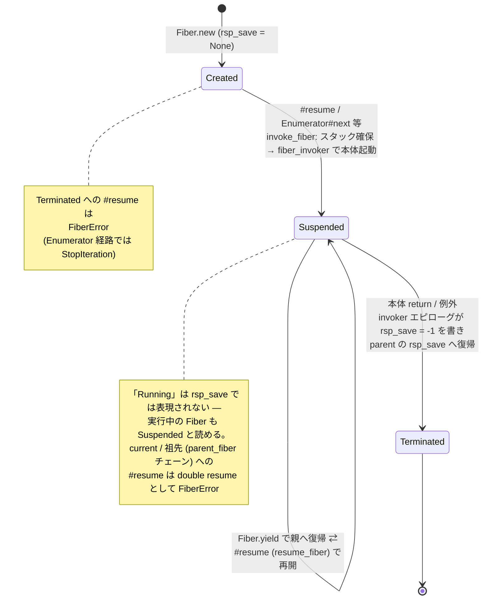
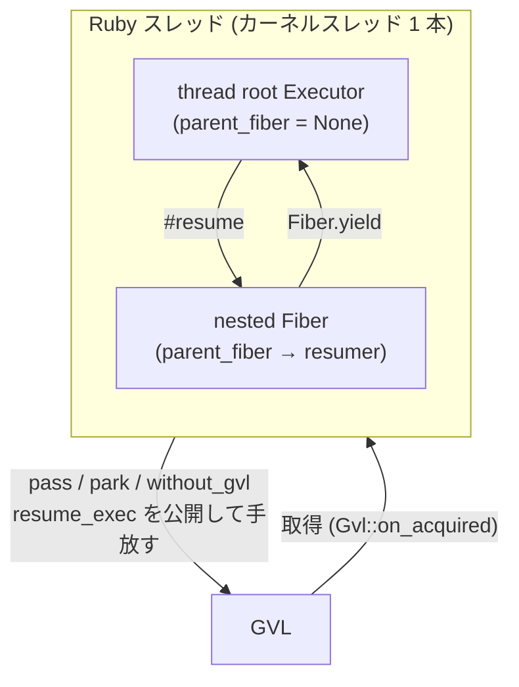

# スレッドと Fiber: Thread / Fiber の状態遷移図

`doc/threads.md` の補足。スレッド registry(`src/scheduler.rs`)と 1:1 モデルの
実装(`src/scheduler/native.rs`)が管理する `ThreadState`
(`src/value/rvalue/thread.rs`)と、Fiber の `FiberState`(`src/executor.rs` の
`fiber_state()`)の状態遷移をまとめる。各 Ruby スレッドはカーネルスレッドで、
GVL を持っている間だけインタプリタに触る(`doc/threads.md` §12)。

## 1. Thread の状態遷移

`ThreadState` は 7 状態:

```
Created | Runnable | Sleeping | Joining | IoWaiting | Blocking | Dead
```

```mermaid
stateDiagram-v2
    [*] --> Created : Thread.new / start / fork<br>spawn() が registry に登録し<br>カーネルスレッドを起こす

    Created --> Runnable : thread_main が GVL を取り run_body が本体起動
    Created --> Dead : 起動前に #kill / #raise が queue 済み<br>本体を実行せず finalize_unstarted()

    Runnable --> Sleeping : Kernel#sleep / Thread.stop<br>(park: GVL を手放し wake pipe を poll)
    Runnable --> Joining : Thread#join / #value<br>(対象の joiners へ登録して park)
    Runnable --> IoWaiting : fd 待ち wait_fd / wait_fds<br>(wake pipe と待つ fd を一緒に poll)
    Runnable --> Blocking : without_gvl<br>(flock / FIFO open / waitpid / 拡張の blocking 呼び出し)
    Runnable --> Runnable : Thread.pass / タイマ・プリエンプション<br>(Gvl::yield_now で GVL を譲る)<br>park_permit 消費時は park が即時復帰
    Runnable --> Dead : 本体 return / 未捕捉例外 /<br>kill unwind 到達 → finalize()

    Sleeping --> Runnable : ① #wakeup / #run<br>② deadline 経過<br>③ #kill / #raise (wake_worthy な割り込み)
    Joining --> Runnable : ① join 対象の死亡 (finalize_common が joiners を起床)<br>② timeout 経過<br>③ #kill / #raise
    IoWaiting --> Runnable : ① fd ready / HUP / error<br>② deadline 経過<br>③ #kill / #raise
    Blocking --> Runnable : 呼び出しの完了 / 割り込み (SIGVTALRM → EINTR)

    Dead --> [*] : registry から prune<br>(ユーザ参照が残る限りオブジェクトは生存)
```

### 遷移の詳細とコード対応

| 遷移 | トリガ | 実装箇所 (`scheduler/native.rs`) |
|---|---|---|
| `[*] → Created` | `Thread.new` が `ThreadInner::new` を生成、`spawn()` が `threads` に登録してカーネルスレッドを起こす | `spawn` |
| `Created → Runnable` | 新しいカーネルスレッドが GVL を取り、`run_body` が本体を始める | `thread_main` / `run_body` |
| `Created → Dead` | 起動前に `#kill` / `#raise` が pending に積まれていた場合、本体を実行せず死亡(CRuby 意味論)。raise は終了例外として記録 | `run_body` → `finalize_unstarted` |
| `Runnable → Sleeping` | `Kernel#sleep` / `Thread.stop`。deadline `None` = `#wakeup` されるまで | `sleep` → `park` |
| `Runnable → Joining` | `Thread#join` / `#value`。対象の `joiners` に登録して park(timeout は park の deadline) | `join` → `park` |
| `Runnable → IoWaiting` | ブロックする IO / `IO.select`。待つ fd と wake pipe を一緒に `poll(2)` | `wait_fds` → `park` |
| `Runnable → Blocking` | fd で待てないカーネル待ち。GVL を外して呼んだカーネルスレッド上で実行 | `without_gvl` / `run_blocking` |
| `Runnable → Runnable` | `Thread.pass`(自発)、またはプリエンプション(`preempt.rs` のタイマが 10 ms ごとに poll フラグを立て、次のセーフポイントで `scheduler::pass`)。GVL の待ち手がいれば譲る | `pass` |
| `Runnable → Dead` | 本体の正常終了(`result` 記録)、未捕捉例外(`exception` 記録)、または kill unwind のスレッド root 到達 | `run_body` 末尾の `finalize` |
| `Sleeping → Runnable` | `#wakeup` / `#run`(park 中でなければ `park_permit` を立てるだけ)/ deadline 経過 / wake に値する割り込み | `wakeup_inner` / `park` / `interrupt` → `wake_parked` |
| `Joining → Runnable` | join 対象の死亡(`finalize_common` が `joiners` を起床)/ timeout / 割り込み | `finalize_common` / `park` / `interrupt` |
| `IoWaiting → Runnable` | fd が ready(HUP / error 含む — 起床側が再試行して実 errno を得る)/ deadline / 割り込み | `park` / `interrupt` |
| `Blocking → Runnable` | 呼び出しの完了。割り込みは `interrupt_blocking` が `SIGVTALRM` で `EINTR` を起こし、戻った側が配送する | `without_gvl` |
| `Dead → (prune)` | `finalize_common` が state を `Dead` にし、joiners を起こし、`threads` registry から除去 | `finalize_common` |

### 注意点

- **「Running」という状態はない**。`Runnable` は「GVL を持っている」と
  「GVL を待っている」の両方を含む。
- **割り込みによる起床は「配送」ではない**。`#kill` / `#raise` は `pending`
  キューに積み、対象が park 中(`Sleeping | Joining | IoWaiting`)かつ
  マスクが全て `:never` でなければ起こすだけ(`wake_parked`)。`Blocking` 中なら
  `interrupt_blocking`。実際の配送は対象が GVL を取り直した後の
  `deliver_pending_now` で行われ、`Thread.handle_interrupt` のマスクに従う。
- **park_permit**(図中の self-loop): *running* な対象への
  `Thread#__wakeup_permit`(Mutex / Queue / ConditionVariable が使用)は
  `park_permit` を立て、対象の次の park は状態遷移せず即時復帰する。
  プリエンプション下の lost-wakeup 窓を塞ぐ(`doc/threads.md` §5)。
  スプリアス起床は常に許容され、呼び出し元のループが条件を再検査する。
- **`Thread.allocate` の shell**(`Process::Waiter` 等)は最初から `Dead` で
  生成され、スケジュールされない。

### `Thread#status` との対応

| `ThreadState` | `#status` | `#alive?` | `#stop?` |
|---|---|---|---|
| `Created` / `Runnable` | `"run"` | true | false |
| `Sleeping` / `Joining` / `IoWaiting` / `Blocking` | `"sleep"` | true | true |
| `Dead`(正常終了 / kill) | `false` | false | true |
| `Dead`(例外終了) | `nil` | false | true |

## 2. Fiber の状態遷移

Fiber の状態は専用フィールドではなく `Executor::rsp_save` から導出される
(`fiber_state()`):

```
rsp_save == None  → Created
rsp_save == -1    → Terminated
それ以外          → Suspended
```





### 遷移の詳細とコード対応

| 遷移 | トリガ | 実装箇所 |
|---|---|---|
| `[*] → Created` | `Fiber.new`(`FiberInner::new`、スタック未確保) | `value/rvalue/fiber.rs` |
| `Created → Suspended`(実行開始) | 初回 `#resume` / `Enumerator#next` / Generator 起動。`initialize()` が 256 KiB スタックを確保し `rsp_save` にスタックトップを書く → `fiber_invoker` | `Fiber::invoke_fiber` / `invoke_fiber_with_self` |
| `Suspended ⇄ Suspended` | `Fiber.yield`(`yield_fiber`: 自分の `rsp_save` に現コンテキストを保存し `parent_fiber` へ switch)と `#resume`(`resume_fiber`: 逆方向) | `executor.rs` / `codegen/arch/*/invoker.rs` |
| `Suspended → Terminated` | 本体の return または例外。`fiber_invoker` のエピローグが `rsp_save = -1` を書いて parent へ復帰 | `codegen/arch/*/invoker.rs` |
| `Terminated → (エラー)` | `#resume` は `FiberError`("attempt to resume a terminated fiber")、Enumerator / Generator 経路は `StopIteration` | `Fiber::resume` / `enum_yield_values` / `generator_yield_values` |

### 注意点

- **エラー遷移(状態は変わらない)**:
  - 実行中の Fiber 自身、または `parent_fiber` チェーン上の祖先への
    `#resume` → `FiberError`(double resume。ライブなスタックへの switch は
    SIGSEGV になるため事前検査)。
  - `parent_fiber == None` のコンテキスト(main、および**スレッド root**)での
    `Fiber.yield` → `FiberError`("can't yield from main fiber")。
- **Thread との関係**: スレッドはそれぞれ自分のカーネルスレッドのスタックで
  走るので、Fiber のスタック切替は使わない。スレッド root の `parent_fiber` は
  常に `None` で、`Fiber.yield` はそこで `FiberError` になる。
- **スレッド内にネストした Fiber**: スレッドが nested Fiber の中で park
  しても、そのカーネルスレッドがそこで止まるだけで、起きればその場から続く。
  park / pass / `without_gvl` は止まっている Executor を `resume_exec` に
  公開し、BOP 再定義の変換とバックトレースがそれを読む。

## 3. 2 つの状態機械の関係



- スレッドの切り替えは GVL の受け渡しで、Fiber の resume/yield は
  スレッド内で完結する(GVL は関与しない)。
- park はどの Fiber の中からでもよく、そのカーネルスレッドはその場で止まるので、
  再開は park 地点へ直接戻る。
